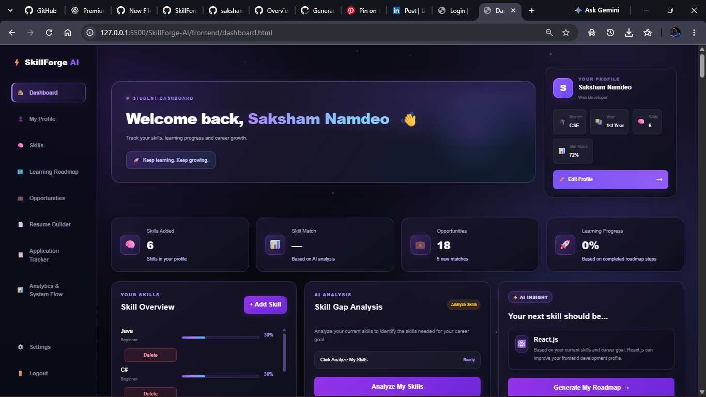

# 🚀 SkillForge-AI

<div align="center">

### Your AI-Powered Career Development Platform

**Learn Smarter. Build Skills. Prepare for Your Future.**

<a href="https://skillforge-ai-frontend-ruddy.vercel.app/login.html">
  
</a>
<a href="https://github.com/sakshamnam/SkillForge-AI">
  
</a>


</div>

---

## 🌟 About The Project

**SkillForge-AI** is an AI-powered career development platform designed to help students improve their skills, explore career opportunities, and prepare for the professional world.

It combines career guidance, skill analysis, interview practice, and portfolio-building tools in one platform.

## ✨ Key Features

| Feature | Description |
|---|---|
| 🤖 AI Assistant | AI-powered career and learning guidance |
| 📊 Skill Gap Analyzer | Identify matching and missing skills |
| 🗺️ Learning Roadmap | Follow a structured learning journey |
| 💼 Career Opportunities | Explore and save opportunities |
| 🎤 Mock Interview | Practice interviews and evaluate performance |
| 📄 Resume Builder | Build a professional resume |
| 🌐 Portfolio Studio | Generate and preview portfolios |
| 📌 Application Tracker | Track applications |
| 👤 Authentication | Register and manage your account |

## 📸 Project Preview

<div align="center">



<sub>SkillForge-AI — Dashboard Preview</sub>

</div>

## 🛠️ Tech Stack

<div align="center">


</div>

| Technology | Purpose |
|---|---|
| HTML5 | Structure |
| CSS3 | Styling and UI |
| JavaScript | Frontend functionality |
| Node.js | Backend runtime |
| Express.js | Backend framework |
| MongoDB | Database |
| Mongoose | Database modeling |
| Google Gemini API | AI-powered features |
| Cloudinary | Media storage |
| JWT | Authentication |

## ⚙️ Getting Started

### Prerequisites

- Node.js and npm
- MongoDB connection
- Google Gemini API key
- Cloudinary credentials for media features

### Installation

**1. Clone the repository**

```bash
git clone https://github.com/sakshamnam/SkillForge-AI.git
```

**2. Navigate to the project**

```bash
cd SkillForge-AI
```

**3. Install backend dependencies**

```bash
cd backend
npm install
```

**4. Configure environment variables**

Create a `.env` file inside the `backend` folder and add the required configuration values.

Never upload API keys, passwords, or `.env` files to GitHub.

**5. Start the backend**

```bash
npm start
```

**6. Run the frontend**

Open the frontend using a local development server such as VS Code Live Server.

## 🎯 Project Vision

To make career preparation more organized and accessible by bringing AI assistance, skill development, interview practice, and career tracking together.

## 🚧 Future Improvements

- More personalized AI recommendations
- Enhanced progress analytics
- Improved mobile responsiveness
- Additional career preparation tools

## 👨‍💻 Developer

<div align="center">

### Saksham Namdeo

**CSE Student | Aspiring Full Stack Developer**

<a href="https://github.com/sakshamnam">
  
</a>
<a href="https://www.linkedin.com/in/saksham-namdeo-9639013b7/">
  
</a>

---

### 💜 Built with passion, curiosity, and a vision to learn.

**Keep Learning. Keep Building. Keep Growing.**

</div>
